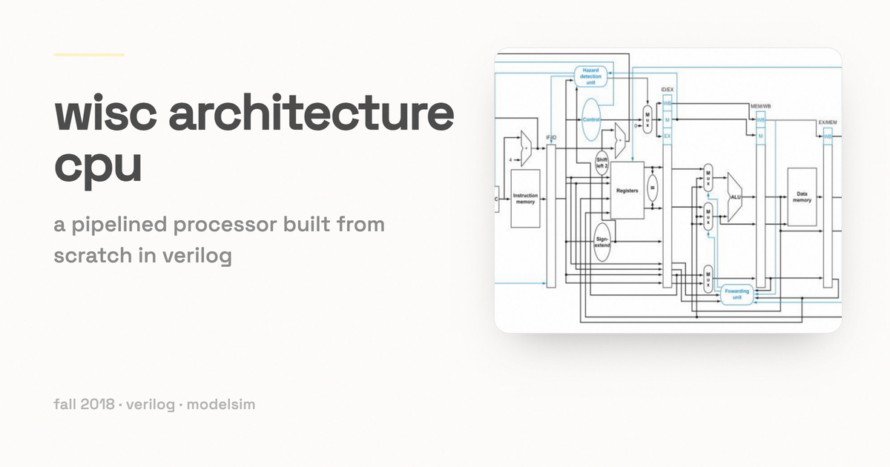

# WiscArchitecture

*A 16-bit processor built from scratch in Verilog, one phase at a time.*

CS/ECE 552 (Computer Architecture) is one of the most involved courses in computer engineering at UW-Madison, and for electrical engineers it counts as senior design. Over the fall 2018 semester our three-person team built a working processor from nothing: ALU, register file, control, pipeline, and cache. Each phase keeps the same instruction set and rebuilds the machine underneath it.

The ISA is documented in the PDF and .docx files inside each phase directory. `ece552f2018-projectreport.doc` is our write-up for the whole project.

## The three phases

### Phase 1 — single-cycle CPU

One instruction per cycle. This phase is the parts bin for everything after it: a 4-bit carry-lookahead adder, the ALU, the shifter, the flags register, the register file with its read and write decoders, PC control, and memory.

### Phase 2 — five-stage pipeline

The same ISA, now pipelined, with a register file that bypasses writes to reads in the same cycle and full forwarding between stages. `forwarding_unit.v` and `Hazard_Detection_Unit.v` do the work, `Branch_Decision_Unit.v` resolves branches, and the four pipeline registers (`Fetch_Decode_Reg.v`, `Decode_Execute_Reg.v`, `Execute_Memory_Reg.v`, `Memory_WriteBack_Reg.v`) hold the state between stages.

### Phase 3 — two-way set-associative cache

A two-way set-associative cache with LRU eviction in front of memory, split into an instruction cache and a data cache. `Cache.sv`, `Cache_Fill.sv`, `DataArray.v`, `MetaDataArray.v`, and `LRUArray.v` are the cache; `multicycle_memory.v` supplies the miss penalty the pipeline has to stall through. `Instructions for Phase 3 Full Test.txt` lists the cases we chased: memory contention when both caches miss at once, branches at the edge of a cache block, and correct LRU updates on hits and evictions.

## Try it yourself

With a Verilog simulator such as ModelSim you can write your own assembly and run it on the processor.

1. Write your program in assembly. The rules are in `WISC-assembler/README`: labels start with `L`, no label at address 0000, shift amounts in decimal, immediates in decimal or hex with a `0x` prefix, and comments with `#` or `//`.
2. Assemble it to a memory image with the Perl assembler:

   ```
   perl WISC-assembler/assembler.pl myprogram.asm > loadfile.img
   ```

3. Point memory at your image. The filename is in the `$readmemh` call inside `memory.v`, or `multicycle_memory.v` in Phase 3.
4. Simulate the phase you want with its testbench: `project-phase1-testbench.v`, `project-phase2-testbench.v`, or `project-phase3-testbench.v`.

Each phase directory also ships the test images and `.list` files we used, so you can start from a program that is known to work.
